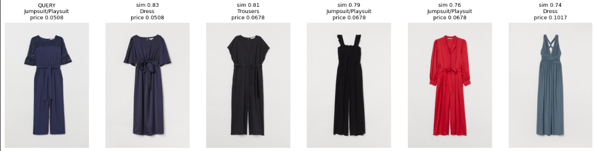

# Dupe Finder

**Upload an outfit photo, pick an item, and find visually similar pieces — sorted by price.**

Inspired by "dupe" culture on social media, Dupe Finder is an end-to-end visual search system for fashion. It combines a data pipeline that prepares and embeds a product catalog with a retrieval service that matches a user's photo to the closest catalog items under a price limit.

> 🚧 **Status:** in active development. See the [roadmap](#roadmap) for progress.
### Early result

FashionCLIP matches by silhouette and style, not just color. Here, a belted wide-leg jumpsuit (left) returns other belted, wide-leg pieces from a 2,000-item H&M sample:



---

## How it works

The system has two halves:

**Offline: catalog pipeline** (runs on a schedule)
1. Ingest product metadata and images
2. Clean and standardize data (categories, prices, broken images, resizing)
3. Embed every product image with [FashionCLIP](https://huggingface.co/patrickjohncyh/fashion-clip)
4. Store vectors and product metadata in a searchable vector index
5. On later runs, process only new or changed products

**Online: search** (every request)
1. User uploads a photo and crops the item they want
2. The crop is embedded with the same model
3. Nearest-neighbor search over the index, filtered by price
4. Return similar items, cheapest first

```
Catalog data → Clean + resize → Embed (FashionCLIP) → Vector index
                                                          ↓
User photo → Crop → Embed query → Search + price filter → Dupe results
```

## Tech stack

| Layer | Tools |
|---|---|
| Data pipeline | Python, PySpark, Dagster / GitHub Actions |
| Storage | Parquet, PostgreSQL |
| Embeddings | PyTorch, Hugging Face Transformers, FashionCLIP |
| Vector search | FAISS |
| Evaluation | pytrec_eval (Recall@k, nDCG@k, MRR) |
| Backend | FastAPI |
| Frontend | React |
| Deployment | Docker, Hugging Face Spaces, Vercel |

The system is designed to run entirely on free-tier infrastructure: embeddings are computed once on a free GPU, and search runs on CPU.

## Evaluation

Retrieval quality is measured on street-to-shop matching (DeepFashion2 consumer-to-shop pairs): given a real-world photo of an item, does the correct catalog product appear in the top results?

| Model | Recall@10 | nDCG@10 | MRR |
|---|---|---|---|
| Color histogram baseline | TBD | TBD | TBD |
| CLIP (ViT-B/32) | TBD | TBD | TBD |
| FashionCLIP | TBD | TBD | TBD |

## Project structure

```
dupe-finder/
├── notebooks/   # exploration, embedding experiments, evaluation
├── pipeline/    # catalog ingestion, cleaning, batch embedding
├── api/         # FastAPI search service
└── frontend/    # React upload-and-search UI
```

## Roadmap

- [x] Project setup
- [ ] Embed catalog sample with FashionCLIP
- [ ] FAISS index + FastAPI search endpoint with price filter
- [ ] React upload and crop UI
- [ ] Deploy live demo
- [ ] Evaluation benchmark (CLIP vs. FashionCLIP vs. baseline)
- [ ] Scheduled incremental pipeline
- [ ] Automatic clothing detection (multiple items per photo)
- [ ] Text + image search ("this, but in black")
- [ ] Beauty shade matching (foundation/lipstick dupes via CIELAB color distance)

## Data

- [H&M Personalized Fashion Recommendations](https://www.kaggle.com/competitions/h-and-m-personalized-fashion-recommendations) — product catalog and images
- [DeepFashion2](https://github.com/switchablenorms/DeepFashion2) — street-to-shop evaluation pairs

Datasets are used under their respective terms and are not redistributed in this repository. Prices in the H&M dataset are scaled values, used here for relative ranking.
